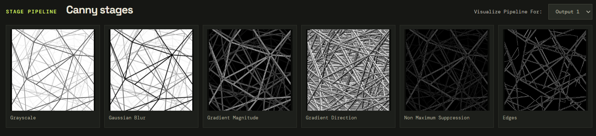

# Contour Lab

Contour Lab is a from-scratch computer-vision pipeline for detecting and
measuring geometric shapes. It combines a FastAPI backend with a React
frontend and keeps each algorithm visible through its inputs, outputs, and
intermediate stages.

## What the project does

The application supports:

- **Canny edge detection**: builds an edge map from an uploaded image.
- **Hough line detection**: votes for line parameters in accumulator space.
- **Ellipse detection**: searches for supported ellipses in an edge map.
- **Circle detection**: provides custom Circular Hough Transform and RANSAC
  implementations, with an optional OpenCV comparison.
- **Active contour (Snake)**: evolves a user-initialized closed contour toward
  image boundaries using a greedy energy-minimization algorithm.
- **Contour measurements**: represents the final contour using Freeman chain
  code and calculates its perimeter and area.

Every detector uses the existing **Input / Output 1 / Output 2** workflow.
Intermediate results are cached by `image_id`, so one operation can reuse the
result of another without re-uploading the image.

## Architecture

The code is intentionally split into four layers:

```text
backend/core/         Pure algorithms and image helpers
backend/models/       Pydantic request contracts and ImageManager
backend/controllers/  Request orchestration and cache selection
backend/views/        FastAPI routes
frontend/             React/Vite user interface
```

The main rule is that algorithms do not know about FastAPI or the frontend.
Routes validate requests, controllers select inputs and cache outputs, and core
modules perform the calculations.

OpenCV is used only through existing decoding, encoding, drawing, and optional
reference-comparison helpers. The primary Canny, Hough, ellipse, circle, Snake,
and contour-measurement logic is implemented manually.

## User workflow

1. Upload an image.
2. Run Canny and save the edge map to Output 1 or Output 2.
3. Select Hough, ellipse, or circle detection and choose its input source.
4. For Snake:
   - choose the number of contour samples;
   - click exactly that many points around the object;
   - the final point is connected to the first automatically;
   - run the greedy active contour;
   - inspect the initial and fitted contours.
5. Inspect the final chain code, perimeter, area, and Pick's-theorem check.

The Snake display keeps the object unchanged. Initial and fitted contours are
drawn on top of the original image, with UI-only controls for line thickness
and optional final vertices.

README media belongs under `docs/images/` for screenshots and still images, or
`docs/gifs/` for animated demonstrations. The placeholder filenames below can
be replaced directly when the final media is available.

## Mathematical basis

### Canny

The image gradient is estimated from horizontal and vertical derivatives:

```text
M(x, y) = sqrt(Gx(x, y)^2 + Gy(x, y)^2)
```

Non-maximum suppression keeps thin local maxima, and hysteresis links strong
edges through weaker connected pixels.

**Examples**




### Hough lines

An image point `(x, y)` votes for lines in polar form:

```text
rho = x cos(theta) + y sin(theta)
```

Peaks in the accumulator represent likely image lines.

**Examples**

<!-- Section screenshot: input source, radius/theta resolution, maximum lines,
     vote threshold, Output 1/Output 2, and accumulator stage. -->


The Hough screenshots use a Canny edge map as input and draw detected lines
over the original image. The comparison view shows the custom accumulator
result beside the OpenCV reference.

### Circle detection

For a circle:

```text
(x - a)^2 + (y - b)^2 = r^2
```

The custom detectors search for likely centers and radii either by voting
(CHT) or by fitting circles to random point triples (RANSAC).

**Examples to add**

<!-- Section screenshot: CHT or RANSAC controls, selected input, Output 1/2,
     detected result, and optional OpenCV comparison. -->


<!-- Focused output: custom circles beside or overlaid with the OpenCV result. -->


Record the selected algorithm, diameter range, vote/inlier controls, input
source, output slot, and whether the OpenCV comparison is enabled.

### Ellipse detection

An ellipse is represented by its center, major/minor semi-axes, and rotation.
The detector searches candidate geometric supports in the edge map and keeps
ellipses that satisfy the configured support and fitting thresholds.

**Examples to add**

<!-- Section screenshot: ellipse parameters, selected input, output slot, and
     the stage pipeline or OpenCV comparison. -->


<!-- Focused output: fitted ellipse overlay, optionally beside the reference. -->


Record `a_min`, `a_max`, vote threshold, fit tolerance, minimum support,
maximum ellipses, RANSAC iterations, input source, and output slot.

### Snake

The greedy Snake minimizes a weighted local energy:

```text
E = alpha E_continuity + beta E_curvature + gamma E_image
```

Intuitively:

- continuity discourages uneven point spacing;
- curvature discourages unwanted sharp changes;
- image energy attracts the contour toward strong boundaries.

The user supplies an initial closed polygon. The algorithm updates each point
by searching a local neighborhood and selecting the lowest-energy candidate.

**Examples to add**

<!-- Animated example: user places exactly n contour points; the last point
     closes the contour back to the first. -->


<!-- Static example: completed initial contour before processing. -->


<!-- Animated example: contour evolution across Snake iterations. -->


<!-- Output example: unchanged object with initial and fitted contours only. -->


<!-- UI example: iterations, chain code, perimeter, area, boundary pixels, and
     Pick's theorem status. -->


Record the sample count, alpha, beta, gamma, window size, maximum iterations,
output slot, display thickness, and vertex visibility.

### Chain code, perimeter, and area

The final floating-point contour is rasterized into an integer 8-connected
pixel path. Each step becomes a Freeman direction code:

```text
orthogonal step = 1
diagonal step   = sqrt(2)
```

Therefore:

```text
P_chain = N_orthogonal + sqrt(2) * N_diagonal
```

The lattice polygon area uses the shoelace equation:

```text
A = 1/2 |sum(x_i y_(i+1) - x_(i+1) y_i)|
```

The pixel-fill result is checked with Pick's theorem:

```text
pixel_fill = shoelace_area + boundary_pixels / 2 + 1
```

The chain-code perimeter is a discrete estimator. For curved shapes it can
overestimate the analytic circumference, so circle validation uses a
one-sided lower-bound check rather than a tight tolerance.

**Measurement example to add**

<!-- Optional focused screenshot of the chain-code and area/perimeter result
     for a known shape, such as the 10-step square. -->


## API overview

| Endpoint | Purpose |
|---|---|
| `POST /api/images` | Upload an image and receive an `image_id`. |
| `GET /api/images/{image_id}` | Retrieve the original image. |
| `POST /api/images/{image_id}/canny` | Run Canny and cache an output slot. |
| `POST /api/images/{image_id}/hough` | Detect lines from a selected input. |
| `POST /api/images/{image_id}/ellipse` | Detect ellipses from Canny output. |
| `POST /api/images/{image_id}/circle` | Run custom circle detection. |
| `POST /api/images/{image_id}/snake` | Evolve a user-initialized contour. |
| `POST /api/images/{image_id}/contour-metrics` | Measure a cached or raw contour. |

Snake contours are cached as:

```text
latest_snake_contour
snake_contour_1
snake_contour_2
```

## Run locally

### Backend

```powershell
cd backend
python -m venv .venv
.\.venv\Scripts\Activate.ps1
pip install -r requirements.txt
cd ..
uvicorn backend.main:app --reload
```

The API is available at `http://localhost:8000`; documentation is at
`http://localhost:8000/docs`.

### Frontend

```powershell
cd frontend
npm install
npm run dev
```

## Validation

Run the deterministic checks from the project root:

```powershell
python -m backend.core.snake.self_check
python -m backend.core.contour_metrics_self_check
python -m compileall -q backend
cd frontend
npm run build
```

The contour checks cover:

- a square with 10 steps per side;
- a diagonal diamond;
- reversed contour order;
- a sampled circle;
- Pick's theorem;
- chain-code closure and perimeter behavior.

## Comparison notes

The project is designed to make custom implementations easy to compare with
reference methods without replacing the custom result.

| Component | Custom method | Reference / comparison | Result to record |
|---|---|---|---|
| Canny | Manual stages | OpenCV Canny / notebook implementation | `[add edge-pixel or difference comparison]` |
| Lines | Custom Hough transform | OpenCV HoughLines | `[add detected-line comparison]` |
| Ellipses | Custom ellipse detector | OpenCV fitEllipse | `[add center/axis comparison]` |
| Circles | CHT or RANSAC | OpenCV HoughCircles | `[add center/radius comparison]` |
| Snake | Greedy active contour | `[add chosen reference if required]` | `[add contour or radius comparison]` |
| Measurements | Freeman chain code | Analytic shapes and Pick's theorem | `[add measured values]` |

For the circle measurement check, document the known chain-code bias instead of
claiming a tight circumference match.

## License

This project is released under the **MIT License**. See
[`LICENSE`](./LICENSE) for the full text.

## Team

- Fahd Ahmed
- Nardeen Ezz
- Mohunad Hassan
- Bassel Shaheen
