<div align="center">

# Contour Lab

### From-Scratch Geometric Vision & Active Contour Pipeline

Interactive computer-vision workbench implementing Canny edge detection, Hough line & circle transforms, RANSAC ellipse/circle fitting, greedy Active Contours (Snakes), and Freeman chain-code morphometry.


<br />

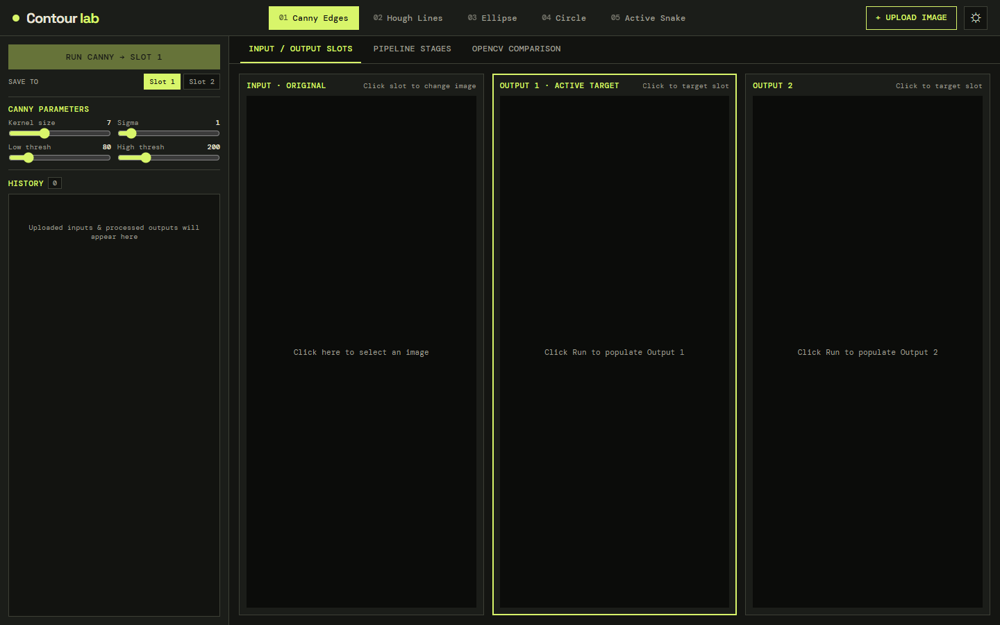

*Figure 1 — Initial Contour Lab workspace (`1440×900`, dark theme) with the 5-module navigation bar, dual target output slots (`Output 1` active), Canny parameter sidebar, and IndexedDB history dock.*

</div>

---

> **Abstract.** **Contour Lab** pairs a pure-algorithm Python core (`backend/core/`) with a FastAPI REST service and a locked-viewport React/Vite interface. Every detector — Canny edges, polar Hough lines, direct conic + RANSAC ellipses, gradient-voted Circular Hough & 3-point RANSAC circles, greedy Active Contours, and Freeman 8-connected chain-code geometry — exposes its intermediate artifacts, supports side-by-side parameter A/B testing across dual output slots, and runs live opt-in comparisons against OpenCV reference calls without altering the custom outputs.

## Table of contents

- [Overview](#overview)
- [Features](#features)
- [Screenshots](#screenshots)
- [How it works](#how-it-works)
- [Tech stack](#tech-stack)
- [Project structure](#project-structure)
- [Quick start](#quick-start)
- [Usage](#usage)
- [API reference](#api-reference)
- [Parameters](#parameters)
- [Performance & caching](#performance--caching)
- [Team](#team)


---

## Overview

Contour Lab separates pure mathematical implementations from HTTP transport and UI state so each vision stage remains inspectable, deterministic, and independently verifiable:

- **Algorithms stay pure:** `backend/core/` modules accept NumPy matrices or raw image bytes and have no dependency on FastAPI or HTTP state.
- **Intermediate visibility:** Multi-stage tabs surface intermediate matrices (`Gaussian Blur`, `Gradient Magnitude`, `Gradient Direction`, `Non Maximum Suppression`, Hough `(rho, theta)` and CHT `(x, y)` accumulators, and per-iteration Snake frames + stage timings).
- **Zero-replace OpenCV benchmarking:** Reference OpenCV calls (`cv2.Canny`, `cv2.HoughLines`, `cv2.fitEllipse`, `cv2.HoughCircles`) run alongside custom outputs using matched blur/edge inputs and linked parameters.

## Features

- **5 Vision Modules:** Canny Edge Detection, Hough Line Transform, Ellipse Detection, Circle Detection (Circular Hough Transform + 3-Point RANSAC), and Greedy Active Contour (Snake).
- **Dual-Slot I/O Workspace:** Route any run into **Output 1** or **Output 2** to compare parameter configurations side by side, and chain Canny slots directly into Hough, Ellipse, and Circle inputs.
- **Interactive Geometric Overlays:** Real-time `min ø` / `max ø` concentric circle diameter guides, optional `a_min` / `a_max` ellipse axis guides, and click-to-place or preset (`Auto Circle` / `Auto Box`) Snake polygons.
- **Active Contour Telemetry & Morphometry:** Frame-by-frame evolution playback, 10-stage wall-clock profiling, Freeman 8-connected chain code, chain-code perimeter, Shoelace area, pixel-fill area, boundary pixel count, and Pick's theorem verification.
- **Persistent Client History & Themes:** Automatic `IndexedDB` (`contour_lab_persistence_v1`) persistence for uploaded inputs, parameter snapshots, and outputs (view process again, reuse any output as a new input, or download PNG), with dark/light mode toggle and responsive mobile layout.

---

## Screenshots

### 1. Canny Edge Detection (`circle_detection.jpg`, `736×978`)

<table>
  <tr>
    <td width="50%" align="center">
      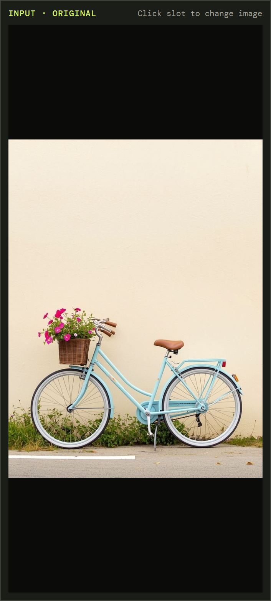<br />
      <sub><b>Figure 2</b> — Clickable original input card (`736×978` RGB photo) captured at `2x` scale.</sub>
    </td>
    <td width="50%" align="center">
      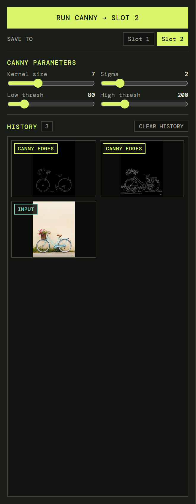<br />
      <sub><b>Figure 3</b> — Canny sidebar (`Kernel size 7`, `Sigma 2`, `Low thresh 80`, `High thresh 200`, target `Slot 2`, History `3`).</sub>
    </td>
  </tr>
</table>

<p align="center">
  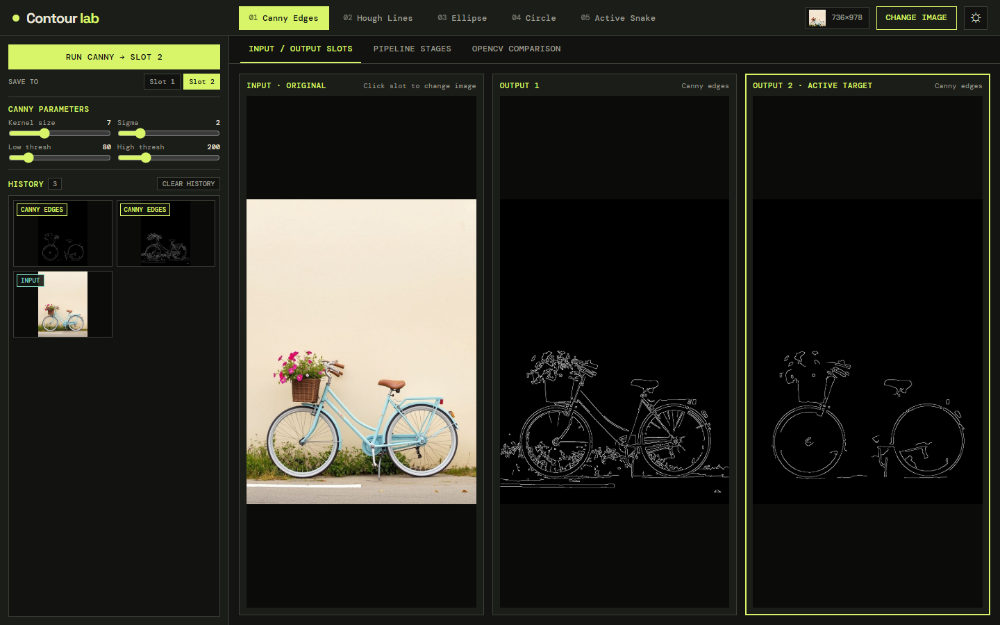<br />
  <sub><b>Figure 4</b> — Dual-slot Canny I/O comparing <b>Output 1</b> (`sigma=1`, preserving fine spoke and foliage detail) against <b>Output 2</b> (`sigma=2`, suppressing high-frequency texture).</sub>
</p>

<p align="center">
  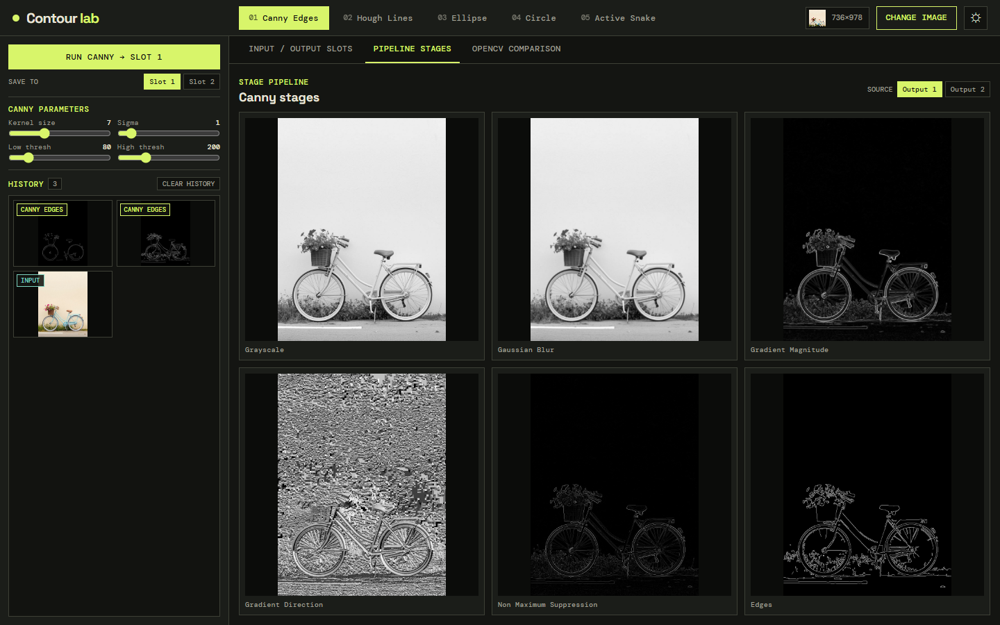<br />
  <sub><b>Figure 5</b> — Canny 6-stage pipeline for <b>Output 1</b> (`sigma=1`, `kernel_size=7`, `low=80`, `high=200`): `Grayscale`, `Gaussian Blur`, `Gradient Magnitude`, `Gradient Direction`, `Non Maximum Suppression`, and hysteresis `Edges`.</sub>
</p>

<p align="center">
  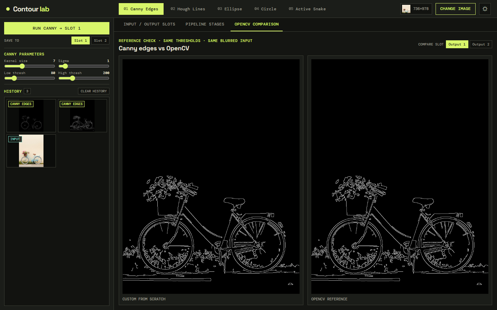<br />
  <sub><b>Figure 6</b> — <b>Output 1</b> Custom Canny vs OpenCV <code>cv2.Canny(..., apertureSize=3, L2gradient=True)</code> evaluated on the identical Gaussian-blurred input with matching thresholds (`80` / `200`).</sub>
</p>

### 2. Hough Line Detection (`ellipse_detectio_noise.jpg`, `736×981`)

<p align="center">
  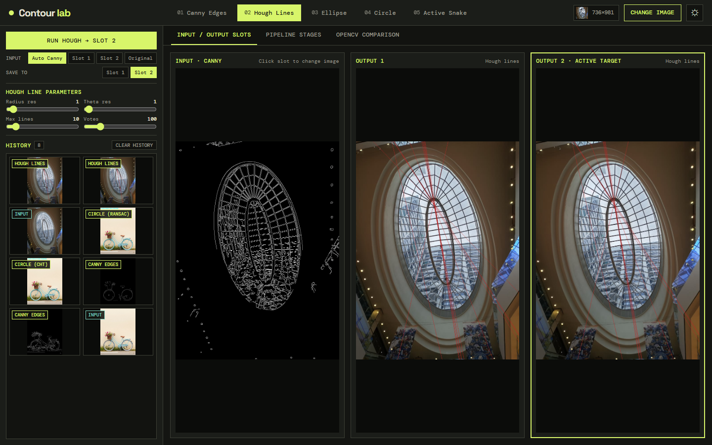<br />
  <sub><b>Figure 7</b> — Dual-slot Hough line detection on the `736×981` skylight edge map (`Auto Canny`): <b>Output 1</b> (`Radius res 1`, `Theta res 1`, `Max lines 12`, `Votes 150`) vs <b>Output 2</b> (`Max lines 10`, `Votes 100`).</sub>
</p>

<p align="center">
  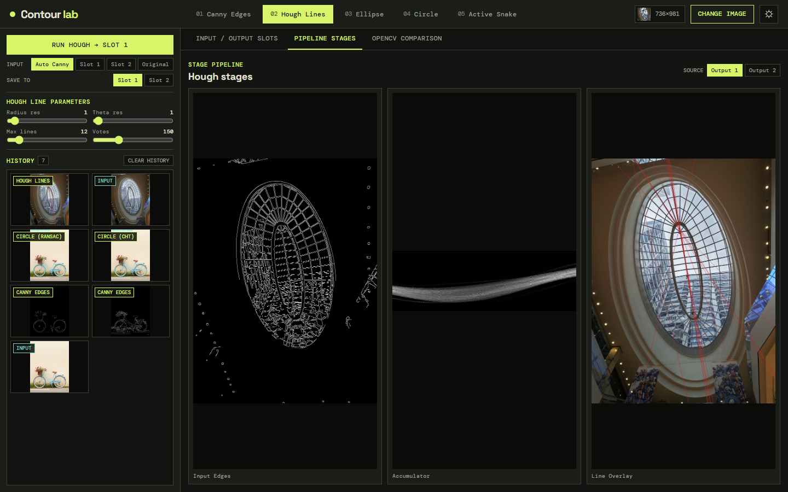<br />
  <sub><b>Figure 8</b> — Hough 3-stage pipeline for <b>Output 1</b> (`Max lines 12`, `Votes 150`): binary `Input Edges`, sinusoidal `(rho, theta)` `Accumulator`, and detected `Line Overlay` aligned along the skylight rib chords.</sub>
</p>

<p align="center">
  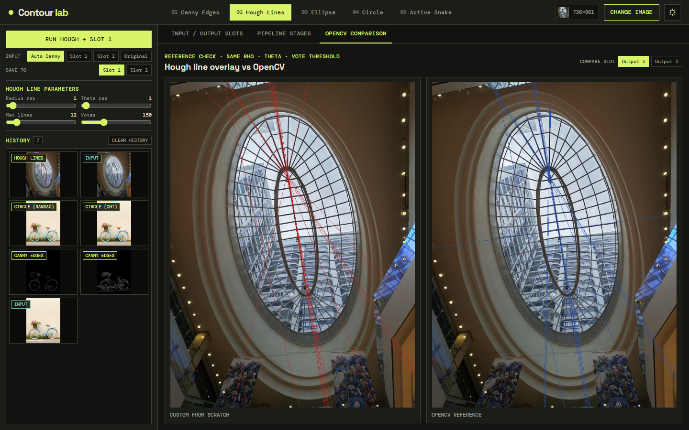<br />
  <sub><b>Figure 9</b> — <b>Output 1</b> Custom Hough line peaks (red) vs OpenCV <code>cv2.HoughLines</code> (blue) using identical `radius_res=1`, `theta_res=1°`, `max_lines=12`, and `vote_threshold=150`.</sub>
</p>

### 3. Ellipse Detection (`ellipse image.jpeg`, `388×288`)

<p align="center">
  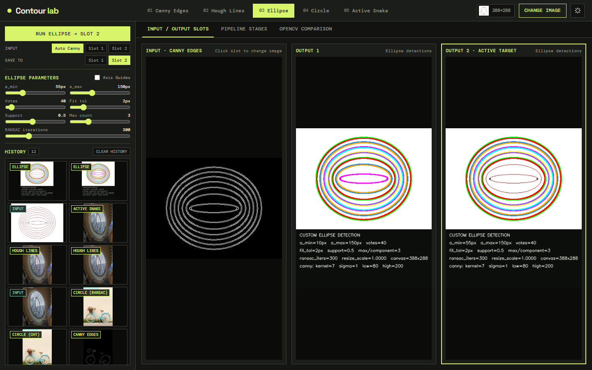<br />
  <sub><b>Figure 10</b> — Concentric ellipse detection (`388×288`, `resize_scale=1.0000`, `a_max=150px`, `votes=40`, `fit_tol=2px`, `support=0.5`, `max/component=3`, `ransac_iters=300`): <b>Output 1</b> (`a_min=10px`) captures all nested rings including the narrow inner ellipse, while <b>Output 2</b> (`a_min=55px`) filters out the inner ellipse cleanly.</sub>
</p>

<p align="center">
  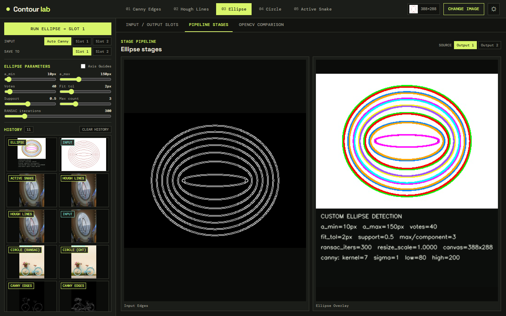<br />
  <sub><b>Figure 11</b> — Ellipse 2-stage pipeline for <b>Output 1</b> (`a_min=10px`): normalized Canny `Input Edges` and annotated `Ellipse Overlay`.</sub>
</p>

<p align="center">
  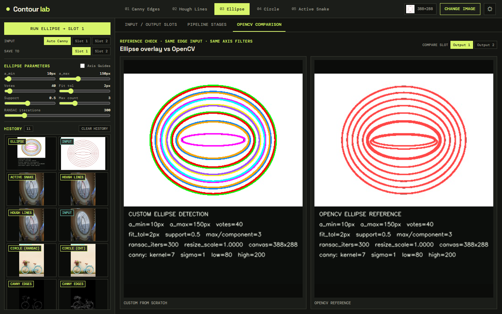<br />
  <sub><b>Figure 12</b> — <b>Output 1</b> Custom direct conic + RANSAC ellipse fit vs OpenCV <code>cv2.fitEllipse</code> reference evaluated on identical `388×288` edge maps and axis bounds (`a_min=10px`, `a_max=150px`).</sub>
</p>

### 4. Circle Detection — Circular Hough & RANSAC (`circle_detection.jpg`, `736×978`)

<table>
  <tr>
    <td width="50%" align="center">
      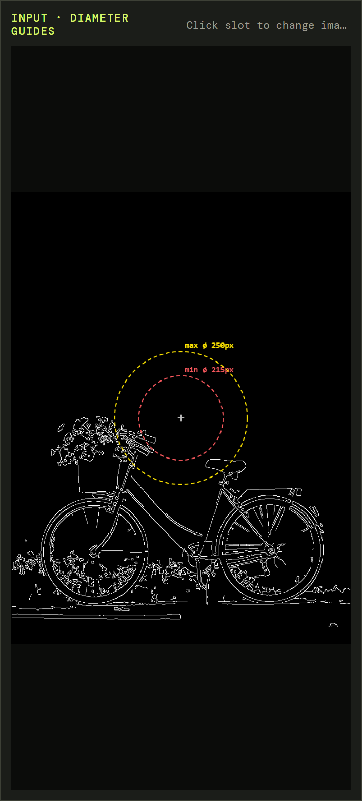<br />
      <sub><b>Figure 13</b> — Interactive `min ø 215px` (red) and `max ø 250px` (yellow) concentric guides overlaid on the bicycle Canny edge map.</sub>
    </td>
    <td width="50%" align="center">
      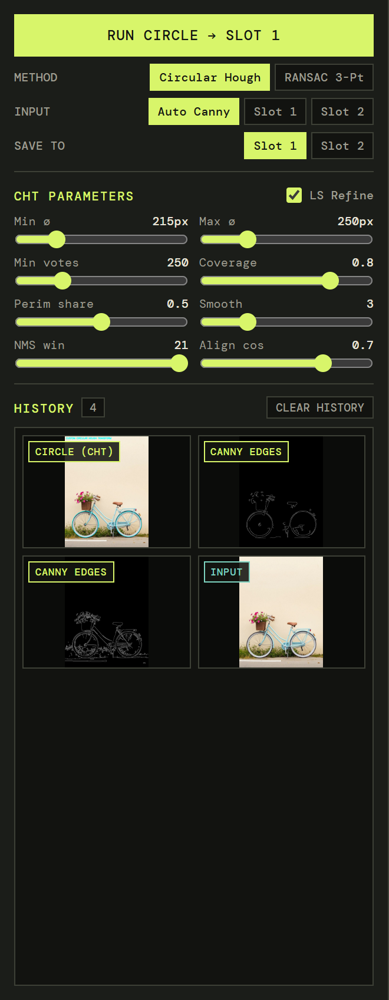<br />
      <sub><b>Figure 14</b> — CHT controls (`Min ø 215px`, `Max ø 250px`, `Min votes 250`, `Coverage 0.8`, `Perim share 0.5`, `Smooth 3`, `NMS win 21`, `Align cos 0.7`, `LS Refine` enabled).</sub>
    </td>
  </tr>
</table>

<p align="center">
  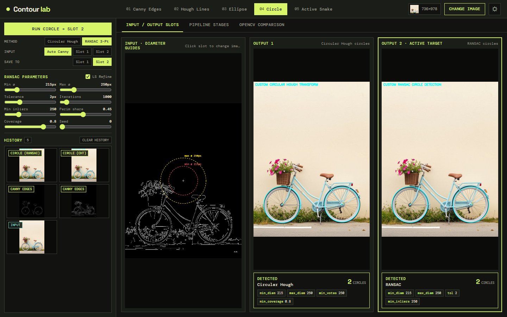<br />
  <sub><b>Figure 15</b> — Dual-slot circle comparison on `736×978` bicycle wheels: <b>Output 1</b> (<code>Circular Hough</code>, `2 CIRCLES`, `min_votes=250`, `min_coverage=0.8`) vs <b>Output 2</b> (<code>RANSAC 3-Pt</code>, `2 CIRCLES`, `tol=2px`, `max_iter=1000`, `min_inliers=250`, `perim_frac=0.45`, `min_coverage=0.8`, `seed=0`).</sub>
</p>

<p align="center">
  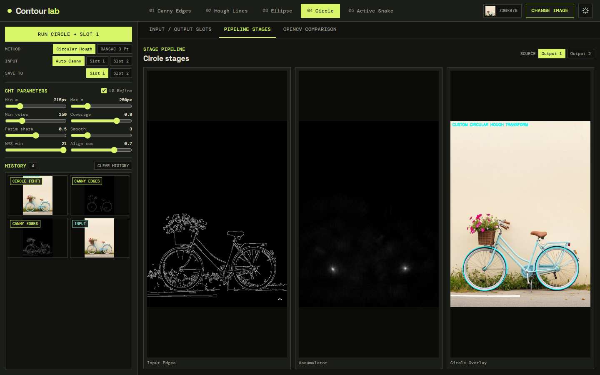<br />
  <sub><b>Figure 16</b> — CHT 3-stage pipeline for <b>Output 1</b>: `Input Edges`, smoothed gradient-voted `Accumulator` showing two distinct wheel-hub vote peaks, and `Circle Overlay`.</sub>
</p>

<p align="center">
  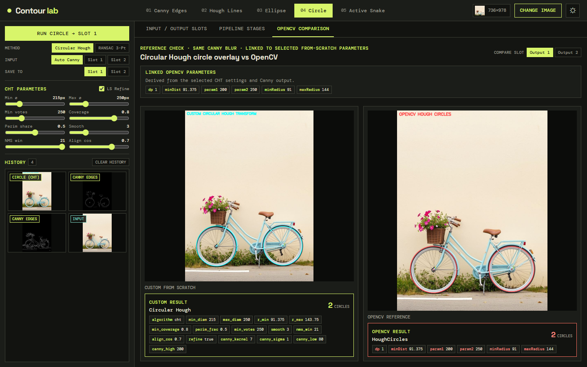<br />
  <sub><b>Figure 17</b> — Live linked comparison: Custom <code>Circular Hough</code> (<code>2 CIRCLES</code>, `r_min=91.375`, `r_max=143.75`, `canny_kernel=7`, `canny_sigma=1`, `canny_low=80`, `canny_high=200`) vs OpenCV <code>HoughCircles</code> (<code>2 CIRCLES</code>, `dp=1`, `minDist=91.375`, `param1=200`, `param2=250`, `minRadius=91`, `maxRadius=144`).</sub>
</p>

### 5. Active Contour (Snake) & Morphometry (`ellipse_detectio_noise.jpg`, `736×981`)

<table>
  <tr>
    <td width="50%" align="center">
      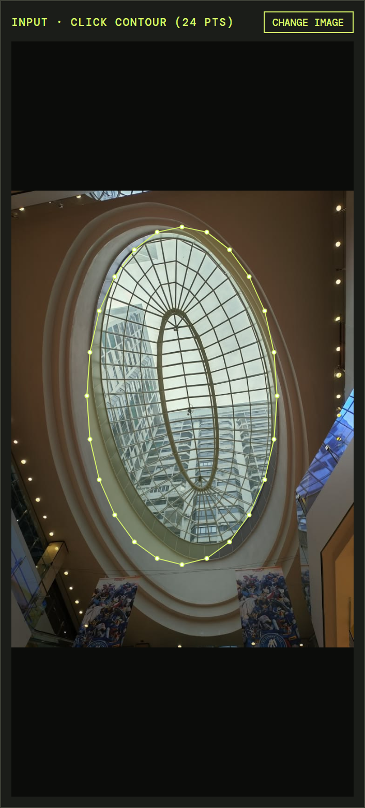<br />
      <sub><b>Figure 18</b> — Interactive 24-vertex closed polygon placed around the `736×981` skylight (`INPUT · CLICK CONTOUR (24 PTS)`).</sub>
    </td>
    <td width="50%" align="center">
      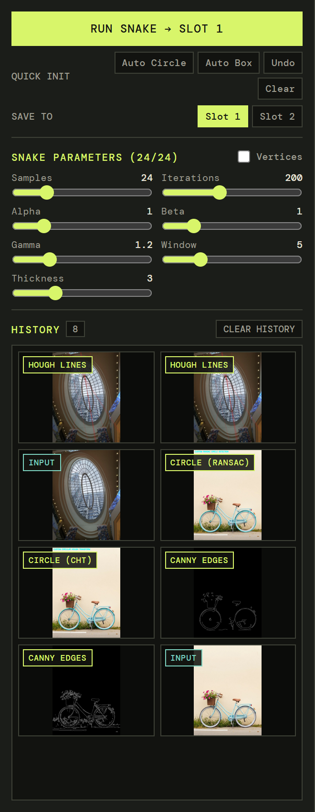<br />
      <sub><b>Figure 19</b> — Active Snake sidebar (`Samples 24`, `Iterations 200`, `Alpha 1`, `Beta 1`, `Gamma 1.2`, `Window 5`, `Thickness 3`) and Quick Init controls.</sub>
    </td>
  </tr>
</table>

<p align="center">
  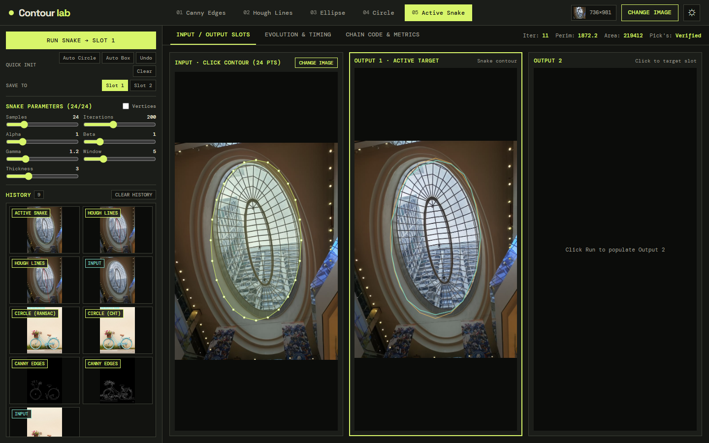<br />
  <sub><b>Figure 20</b> — Snake I/O workspace showing initial polygon (amber) vs converged fit (mint) alongside the live header summary (`Iter: 11`, `Perim: 1872.2`, `Area: 219412`, `Pick's: Verified`).</sub>
</p>

<p align="center">
  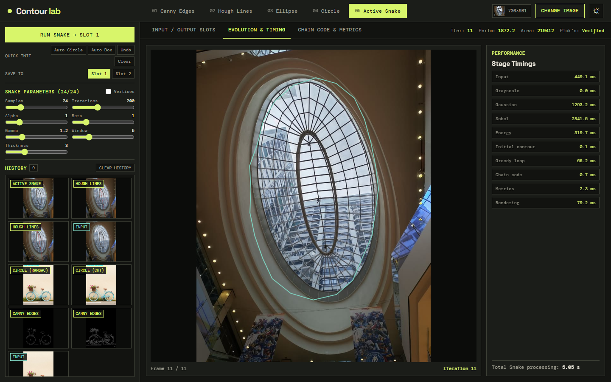<br />
  <sub><b>Figure 21</b> — Evolution & Timing view at convergence (<code>Frame 11 / 11</code>, <code>Iteration 11</code>) with 10-stage wall-clock profiling totaling <b>`5.05 s`</b> (`Input 449.1 ms`, `Grayscale 0.0 ms`, `Gaussian 1293.2 ms`, `Sobel 2841.5 ms`, `Energy 319.7 ms`, `Initial contour 0.1 ms`, `Greedy loop 66.2 ms`, `Chain code 0.7 ms`, `Metrics 2.3 ms`, `Rendering 79.2 ms`).</sub>
</p>

<p align="center">
  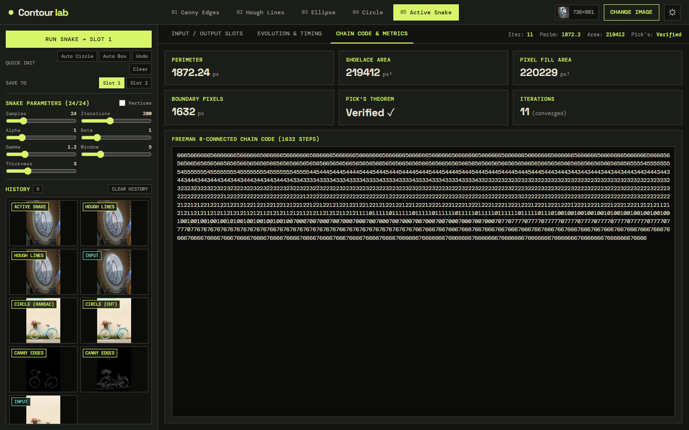<br />
  <sub><b>Figure 22</b> — Morphometry output: `PERIMETER 1872.24 px`, `SHOELACE AREA 219412 px²`, `PIXEL FILL AREA 220229 px²`, `BOUNDARY PIXELS 1632 px`, `PICK'S THEOREM Verified ✓`, `ITERATIONS 11 (converged)`, and the 1,632-step Freeman 8-connected chain code.</sub>
</p>

### 6. Light Theme, History & Responsive Mobile

<p align="center">
  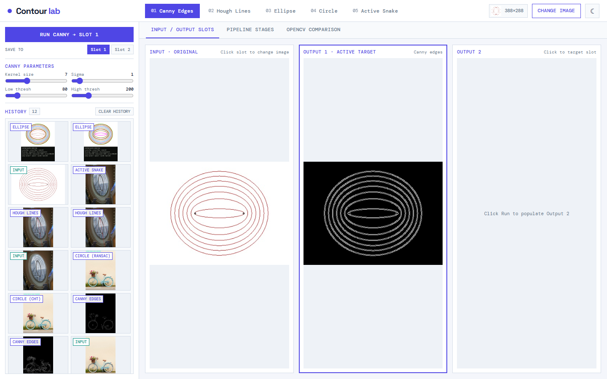<br />
  <sub><b>Figure 23</b> — Light theme (`html.light`) showing `388×288` Canny edges in <b>Output 1</b> and `12` persisted session entries in the `IndexedDB` History panel.</sub>
</p>

<p align="center">
  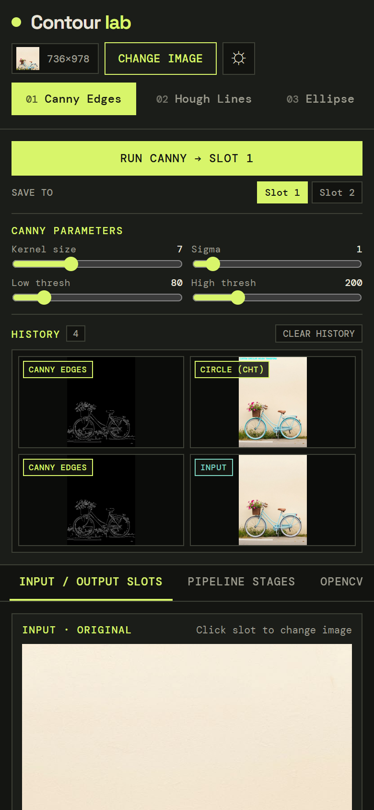<br />
  <sub><b>Figure 24</b> — Responsive mobile layout (`390×844` at `2x` DPR, `scrollWidth = 390 px`, zero horizontal overflow) stacking top navigation, parameters, persisted history, and viewer cards cleanly.</sub>
</p>

---

## How it works

### Architecture

The backend follows a four-layer Model–View–Controller layout so pure mathematical code stays decoupled from FastAPI routes and client persistence:

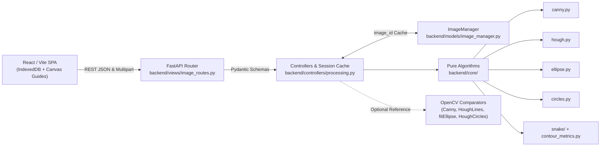

### Mathematical & Algorithmic Basis

1. **Canny Edge Detection (`backend/core/canny.py`):**
   Converts RGB to luminance (`0.299R + 0.587G + 0.114B`), convolves with a normalized 2D Gaussian kernel (`ALLOWED_KERNEL_SIZES = (3, 5, 7, 9, 15)`), computes 3×3 Sobel derivatives `Gx`, `Gy`, magnitude `M = sqrt(Gx^2 + Gy^2)`, and angle `atan2(Gy, Gx)`, thins ridges via 4-sector non-maximum suppression, and connects weak pixels (`>= low_threshold`) reachable from strong pixels (`>= high_threshold`) with 8-connected DFS hysteresis.

2. **Hough Line Transform (`backend/core/hough.py`):**
   Every nonzero edge pixel `(x, y)` casts votes across discretized orientations `theta in [0, 180)` into polar bins:
   ```text
   rho = x * cos(theta) + y * sin(theta)
   ```
   Local maxima above `vote_threshold` within a 3×3 (`neighborhood=1`) window are sorted by votes and capped at `max_lines`.

3. **Ellipse Detection (`backend/core/ellipse.py`):**
   Resizes larger images (when `resize_input=true`) to `ELLIPSE_MAX_DIM = 400`, extracts 8-connected edge components, and runs localized RANSAC (`sample_size=6` points within `2 * a_max` of a seed pixel) using normalized direct least-squares conic fitting (`4AC - B^2 > 0`). Inliers are measured with first-order Sampson distance, iteratively refined (3 passes), and filtered against `a_min`, `a_max`, `min_points` (`vote_threshold`), `max_aspect=10.0`, and Ramanujan perimeter support:
   ```text
   P_ellipse ≈ pi * (3(a + b) - sqrt((3a + b)(a + 3b)))
   support   = n_inliers / P_ellipse
   ```

4. **Circle Detection (`backend/core/circles.py`):**
   Maps user diameter bounds to search radii `[0.85 * min_diam / 2, 1.15 * max_diam / 2]` and runs one of two detectors:
   - **Circular Hough Transform (`cht`):** Computes Sobel gradients on the cached Gaussian-blurred image, projects votes along `+/- normal` across candidate radii, box-smooths and non-max-suppresses the 2D center accumulator, selects histogram radius peaks with radial alignment `>= align_cos`, optionally applies Kasa algebraic least-squares refinement (`refine=true`), and enforces `perim_frac`, `min_coverage`, and NMS (`nms_circles`).
   - **RANSAC 3-Point (`ransac`):** Evaluates vectorized batches of random non-collinear triples `(p1, p2, p3)`, fits the exact circumcircle, refines inliers via Kasa LSQ, checks `min_inliers`, `perim_frac`, and 36-bin `angular_coverage`, and removes matched inliers iteratively up to 30 circles.

5. **Greedy Active Contour / Snake (`backend/core/snake/`):**
   Pure-Python pipeline (zero OpenCV/NumPy in `backend/core/snake/` — Pillow used solely in `decode.py` for decoding, plus a hand-written `zlib`/`struct` PNG encoder in `png.py`). Minimizes per-vertex energy over a `window_size × window_size` grid using independently min-max-normalized terms and already-updated predecessors:
   ```text
   E_contour = alpha * E_continuity + beta * E_curvature + gamma * E_image
   E_image   = -|grad(I_sigma)|^2 / max(|grad(I_sigma)|^2)
   ```
   Supports optional local-maximum curvature corner relaxation (`beta -> 0` where curvature and gradient exceed thresholds) and stops when fewer than `movement_threshold` points move or `max_iterations` is reached.

6. **Freeman Chain Code & Morphometry (`backend/core/snake/chain_code.py`, `metrics.py`, `contour_metrics.py`):**
   Rasterizes rounded polygon edges via Bresenham into an 8-connected closed pixel loop (`DIRECTIONS`: `0` east through `7` southeast), computes chain perimeter (`1` orthogonal, `sqrt(2)` diagonal), lattice Shoelace area, and verifies pixel-fill consistency against Pick's theorem:
   ```text
   P_chain    = N_orthogonal + sqrt(2) * N_diagonal
   A_shoelace = 1/2 * |sum(x_i * y_(i+1) - x_(i+1) * y_i)|
   pixel_fill = A_shoelace + boundary_pixels / 2 + 1
   ```

---

## Tech stack

| Layer | Technology | Version / Spec | Purpose |
| --- | --- | --- | --- |
| API Server | `FastAPI` + `Uvicorn` | `>=0.115` / `>=0.30` | REST endpoints, OpenAPI `/docs`, CORS middleware |
| Validation | `Pydantic` | `>=2.7` | Request/response contracts and parameter bounds |
| Numerical Core | `NumPy` + `Python` | `>=1.26` / `3.11+` | Vectorized array processing & pure-Python Snake engine |
| Codec & Reference | `opencv-python-headless` + `Pillow` | `>=4.10` / `>=10.0` | Image encode/decode, line/circle drawing, OpenCV comparisons |
| Frontend UI | `React` + `React DOM` | `^18.3.1` | Interactive dual-slot UI, Canvas guides, SVG Snake editor |
| Build Tooling | `Vite` + `@vitejs/plugin-react` | `^5.4.8` / `^4.3.1` | Fast HMR dev server and static production bundling |
| Client Storage | Browser `IndexedDB` + `localStorage` | `contour_lab_persistence_v1` | Persistent input/output history, workspace restore, theme state |

---

## Project structure

```text
Geometric-Contour-Pipeline/
├── backend/
│   ├── main.py                      # FastAPI app, CORS (localhost:5173), /health
│   ├── requirements.txt             # Python dependencies
│   ├── controllers/
│   │   └── processing.py            # Orchestration, resizing, OpenCV reference comparators
│   ├── core/
│   │   ├── canny.py                 # Gaussian blur, Sobel, NMS, hysteresis thresholding
│   │   ├── hough.py                 # Polar Hough accumulator, peak NMS, line drawing
│   │   ├── ellipse.py               # Connected components, direct conic fit, RANSAC, Sampson error
│   │   ├── circles.py               # Circular Hough Transform, 3-pt RANSAC, Kasa LSQ, OpenCV wrapper
│   │   ├── contour_metrics.py       # Lattice Pick's theorem verifier, pixel-fill & Shoelace metrics
│   │   ├── contour_metrics_self_check.py
│   │   ├── image_codec.py           # RGB/BGR safe encoding, base64 data URLs, step serialization
│   │   └── snake/                   # Dependency-free pure-Python active contour package
│   │       ├── pipeline.py          # 10-stage pipeline & wall-clock profiler
│   │       ├── greedy.py            # Greedy energy minimizer & corner relaxation
│   │       ├── energy.py            # Normalized negative squared gradient map
│   │       ├── gaussian.py          # Separable 1D Gaussian blur
│   │       ├── gradient.py          # 3x3 Sobel gradient operator
│   │       ├── grayscale.py         # ITU-R BT.601 luminance conversion
│   │       ├── contour.py           # Preset shapes, clamping, uniform arc-length resampling
│   │       ├── chain_code.py        # Bresenham rasterizer & 8-connected Freeman codes
│   │       ├── metrics.py           # Chain perimeter, Shoelace, Green's & scanline areas
│   │       ├── decode.py            # Pillow RGBA container decoding
│   │       ├── png.py               # Manual struct + zlib RGBA PNG writer
│   │       ├── render.py            # Pure-Python contour/vertex RGBA rasterizer
│   │       ├── constants.py         # Defaults, Freeman 8-directions, overlay colors
│   │       └── self_check.py        # Deterministic unit verification suite
│   ├── models/
│   │   ├── image_manager.py         # Thread-safe in-memory ImageSession & result cache
│   │   ├── schemas.py               # Pydantic contracts for Canny, Hough, Ellipse, Circle, Metrics
│   │   └── snake_models.py          # SnakePoint and SnakeRequest contracts
│   └── views/
│       └── image_routes.py          # /api/* FastAPI route handlers
├── frontend/
│   ├── index.html                   # HTML5 entry with responsive mobile viewport meta
│   ├── package.json                 # React 18.3.1 / Vite 5.4.8 dependencies & scripts
│   ├── vite.config.js               # Vite React plugin config
│   └── src/
│       ├── main.jsx                 # 5-tab workbench, Canvas guides, Snake SVG, IndexedDB history
│       └── styles.css               # Dark/light theme variables, locked 100vh grid & mobile media query
├── docs/
│   ├── images/                      # Source sample assets & legacy stage figures
│   ├── screenshots/                 # Verified 24-PNG screenshot suite & index README
│   └── gifs/
├── images/                          # Test image assets (circle, concentric ellipses, skylight)
├── notebooks/                       # Exploratory Jupyter notebooks (Canny/Hough, Circles, Ellipses)
├── .gitignore
├── LICENSE
└── README.md
```

---

## Quick start

### Prerequisites

- **Python 3.11+**
- **Node.js 20+** and **npm**

### 1. Backend

**Windows (PowerShell):**

```powershell
python -m venv .venv
.\.venv\Scripts\Activate.ps1
pip install -r backend/requirements.txt
python -m uvicorn backend.main:app --reload --port 8000
```

**macOS / Linux (Bash):**

```bash
python3 -m venv .venv
source .venv/bin/activate
pip install -r backend/requirements.txt
python3 -m uvicorn backend.main:app --reload --port 8000
```

Verify the API is healthy at `http://localhost:8000/health` (`{"status":"ok"}`) or explore interactive docs at `http://localhost:8000/docs`.

### 2. Frontend

In a second terminal:

```powershell
cd frontend
npm install
npm run dev
```

Open `http://localhost:5173/` in your browser. *(On Windows PowerShell, if execution policy blocks `npm.ps1`, run `cmd /c "npm.cmd install"` and `cmd /c "npm.cmd run dev"`.)*

### 3. Deterministic Verification

Run backend checks and the frontend production build from the repository root:

```bash
python -m backend.core.snake.self_check
python -m backend.core.contour_metrics_self_check
python -m compileall -q backend
cd frontend && npm run build
```

---

## Usage

1. **Upload an image:** Click `+ Upload Image` in the top bar or click directly inside any **Input** card to load a local image (such as `images/circle_detection.jpg`, `images/ellipse_detectio_noise.jpg`, or `images/ellipse image.jpeg`). Uploading automatically registers an `image_id` session and populates Canny **Output 1** with default settings (`7, 1, 80, 200`).
2. **A/B Test Across Dual Slots:** Select `Slot 1` or `Slot 2` under `Save To`, tune parameters, and click **Run** to compare two parameter sets side by side in the I/O workspace.
3. **Chain Pipelines:** In `02 Hough Lines`, `03 Ellipse`, or `04 Circle`, choose `Auto Canny` (recomputes using current Canny sliders), `Slot 1`, or `Slot 2` under `Input` (Hough also accepts `Original`).
4. **Inspect Stages & OpenCV Reference:** Switch subtabs to **Pipeline Stages** to inspect intermediate buffers/accumulators, or **OpenCV Comparison** to compare custom outputs against OpenCV on matched inputs (Circle and Ellipse live-refresh OpenCV comparisons automatically as sliders move).
5. **Evolve & Measure Active Contours:** In `05 Active Snake`, use `Auto Circle`, `Auto Box`, or click individual points directly on the image until reaching `Samples` (`n_points`), then click **Run Snake**. Switch to **Evolution & Timing** for frame playback and stage profiling, or **Chain Code & Metrics** for Freeman codes, area, perimeter, and Pick's theorem validation.
6. **Reuse History:** Click any card in the left **History** dock to view a prior run's settings and outputs, hover to reuse an output as a new input image, or download the PNG.

---

## API reference

All routes except `/health` are mounted under `/api` in `backend/main.py` and defined in `backend/views/image_routes.py`.

| Method & Endpoint | Request Body / Input | Description |
| --- | --- | --- |
| `GET /health` | — | Health check returning `{"status": "ok"}`. |
| `POST /api/images` | `multipart/form-data` (`file`) | Decode uploaded image (`image/*`) and return `{ image_id, width, height, channels }`. |
| `GET /api/images/{image_id}` | — | Return `{ image_id, original }` as a base64 PNG data URL. |
| `POST /api/images/{image_id}/canny` | `CannyRequest` | Run Canny detector, cache edge map & blur under `output_slot` (`1`\|`2`), return custom/OpenCV outputs & 6 steps. |
| `POST /api/images/{image_id}/canny-comparison` | `CannyComparisonRequest` | Diagnostic comparison between production Canny and `MAX_DIM=400` notebook Canny/ellipse outputs. |
| `POST /api/images/{image_id}/hough` | `HoughRequest` | Detect polar Hough lines from `original`, `canny`, `output1`, or `output2`; returns lines, accumulator step, and OpenCV comparison. |
| `POST /api/images/{image_id}/ellipse` | `EllipseRequest` | Detect ellipses from Canny edge maps (`canny`, `output1`, `output2`) with optional `MAX_DIM=400` resize and OpenCV comparison. |
| `POST /api/images/{image_id}/ellipse/compare` | `EllipseRequest` | Re-run only the `cv2.fitEllipse` reference overlay on an existing Canny map. |
| `POST /api/images/{image_id}/circle` | `CircleRequest` | Run `cht` or `ransac` circle detection on cached Canny edges + blur; returns detected circles, accumulator (CHT), and optional OpenCV result. |
| `POST /api/images/{image_id}/circle/compare` | `CircleRequest` | Re-run only the linked `cv2.HoughCircles` reference comparison. |
| `POST /api/images/{image_id}/snake` | `SnakeRequest` | Evolve an `n_points`-vertex closed polygon, returning frames, final contour, stage timings, Freeman chain code, and Pick metrics. |
| `POST /api/images/{image_id}/contour-metrics` | `ContourMetricsRequest` | Compute chain code, perimeter, Shoelace area, pixel-fill area, and Pick verification for `snake`, `output1`, `output2`, or `raw` points. |
| `POST /api/images/{image_id}/pipeline` | `PipelineRequest` | Single-shot combined Canny + Hough execution returning `original`, `canny`, and `hough`. |

---

## Parameters

### Canny (`CannyRequest`)

| Parameter | UI Label | Default | Range / Values | Effect |
| --- | --- | --- | --- | --- |
| `kernel_size` | `Kernel size` | `7` | `3, 5, 7, 9, 15` | Odd Gaussian filter size (`ALLOWED_KERNEL_SIZES`; `11` and `13` rejected with HTTP `422`). |
| `sigma` | `Sigma` | `1.0` | `0.1`–`10` (`> 0`) | Gaussian smoothing standard deviation; higher values suppress fine texture. |
| `low_threshold` | `Low thresh` | `80.0` | `0`–`500` (`>= 0`) | Hysteresis weak-edge connectivity floor. |
| `high_threshold` | `High thresh` | `200.0` | `0`–`800` (`>= low_threshold`) | Strong-edge seed threshold for hysteresis linking. |

### Hough Lines (`HoughRequest`)

| Parameter | UI Label | Default (UI / API) | Range / Values | Effect |
| --- | --- | --- | --- | --- |
| `input_source` | `Input` | `canny` | `canny`, `output1`, `output2`, `original` | Source matrix used as votes input (`output1`/`2` reuse Canny slots). |
| `radius_res` | `Radius res` | `1.0` | `0.5`–`10` (`> 0`) | Polar distance `rho` bin width in pixels. |
| `theta_res` | `Theta res` | `1.0` | `0.5`–`20` (`(0, 180]`) | Orientation `theta` quantization step in degrees. |
| `max_lines` | `Max lines` | `100` / `10` | `1`–`100` | Maximum accumulator peaks drawn after 3×3 suppression. |
| `vote_threshold` | `Votes` | `2` / `20` | `0`–`500` (`>= 0`) | Minimum edge-pixel votes required for a line peak. |

### Ellipse (`EllipseRequest`)

| Parameter | UI Label | Default | Range / Values | Effect |
| --- | --- | --- | --- | --- |
| `a_min` | `a_min` | `10.0` px | `2`–`200` (`> 0`, `<= a_max`) | Minimum minor semi-axis length accepted after fitting. |
| `a_max` | `a_max` | `150.0` px | `10`–`400` (`> 0`) | Maximum major semi-axis length and localized sampling radius (`2 * a_max`). |
| `vote_threshold` | `Votes` | `40` | `10`–`500` | Minimum supporting inlier edge pixels per ellipse (`min_points`). |
| `fit_tol` | `Fit tol` | `2.0` px | `0.5`–`8.0` | Maximum Sampson geometric distance for an inlier pixel. |
| `min_support` | `Support` | `0.5` | `0.1`–`1.0` | Minimum `n_inliers / P_ellipse` perimeter coverage ratio. |
| `max_ellipses` | `Max count` | `3` | `1`–`8` | Maximum ellipses extracted per connected edge component. |
| `ransac_iters` | `RANSAC iterations` | `300` | `50`–`1500` | Localized 6-point hypotheses sampled per component search. |
| `resize_input` | *(API)* | `true` | `bool` | Normalizes larger inputs to `ELLIPSE_MAX_DIM = 400` (nearest-neighbor binary edges). |

### Circle (`CircleRequest`)

| Parameter | Method | Default (UI / API) | Range / Values | Effect |
| --- | --- | --- | --- | --- |
| `algorithm` | Both | `cht` | `cht`, `ransac` | Selects Circular Hough Transform or 3-Point RANSAC. |
| `min_diam` / `max_diam` | Both | `150` / `260` px | `4`–`1000` (`4`–`10000` API) | Search diameter bounds mapped via `0.85 * min_diam / 2` to `1.15 * max_diam / 2`. |
| `perim_frac` | Both | `0.45` | `0.0`–`1.0` | Minimum fraction of `2 * pi * r` required as supporting edge pixels. |
| `min_coverage` | Both | `0.55` CHT / `0.65` UI RANSAC | `0.1`–`1.0` | Minimum 36-bin angular coverage (`0..360°`) around circumference. |
| `refine` | Both (`LS Refine`) | `true` | `bool` | Re-fits accepted inliers with Kasa algebraic least-squares circle fitting. |
| `min_votes` | `cht` | `80` | `5`–`1000` (`5`–`100000` API) | Minimum accumulator / radial peak votes (also mapped to OpenCV `param2`). |
| `smooth` / `nms_win` | `cht` | `3` / `11` | `1`–`9` / `3`–`21` (odd) | Box filter size for accumulator smoothing and spatial peak NMS window. |
| `align_cos` | `cht` | `0.7` | `0.0`–`0.95` | Minimum `\|cos(angle)\|` alignment between Sobel gradient and radius vector. |
| `tol` / `max_iter` / `min_inliers` / `seed` | `ransac` | `2.0` / `1000` / `80` / `0` | `0.5`–`6` / `100`–`10000` / `5`–`1000` / `0`–`99` | Radial inlier tolerance, hypothesis budget, support floor, and RNG seed. |

### Active Snake (`SnakeRequest` + UI Display)

| Parameter | UI Label | Default (UI / API) | Range / Values | Effect |
| --- | --- | --- | --- | --- |
| `n_points` | `Samples` | `20` | `3`–`100` (`3`–`200` API) | Number of vertices in the closed polygon contour. |
| `max_iterations` | `Iterations` | `200` | `1`–`500` (`1`–`1000` API) | Maximum greedy evolution passes before stopping. |
| `alpha` / `beta` / `gamma` | `Alpha` / `Beta` / `Gamma` | `1.0` / `1.0` / `1.2` | `0.0`–`5.0` (`>= 0`) | Continuity (spacing), curvature (smoothness), and image-gradient attraction weights. |
| `window_size` | `Window` | `5` | `3`–`11` (odd) | Local `window_size × window_size` candidate search neighborhood around each vertex. |
| `movement_threshold` | *(API)* | `1` | `>= 0` | Stops early (`converged`) when fewer than this many vertices move in a pass. |
| `gaussian_sigma` | *(API)* | `1.0` | `>= 0` | Standard deviation of the separable Gaussian pre-blur before Sobel energy. |
| `corner_relaxation` / `corner_threshold` | *(API)* | `true` / `0.1` | `bool` / `>= 0` | Relaxes `beta = 0` at sharp corners with high image gradient. |
| `resample_every_k` | *(API)* | `0` | `>= 0` | Uniformly resamples vertices every `k` iterations (`0` disables resampling). |
| `displayThickness` / `showVertices` | `Thickness` / `Vertices` | `3` / `false` | `1`–`8` / `bool` | UI-only Canvas rendering controls for final contour stroke width and vertex dots. |

---

## Performance & caching

- **Server-side session cache (`backend/models/image_manager.py`):** Each uploaded image is stored in memory under a UUID `image_id` alongside cached artifacts (`canny:<json>`, `latest_canny`, `canny_output_1`/`2`, `latest_canny_blur`, `canny_blur_output_1`/`2`, `latest_canny_params`, `canny_params_output_1`/`2`, `hough_output_1`/`2`, `ellipse_output_1`/`2`, `circle_output_1`/`2`, `snake_output_1`/`2`, `snake_contour_1`/`2`, `latest_snake_contour`, `contour_metrics_output_1`/`2`). Re-running downstream detectors reuses cached edge maps and Gaussian blurs without recomputing Canny.
- **Ellipse canvas normalization (`ELLIPSE_MAX_DIM = 400`):** Large images are downscaled proportionally for ellipse fitting (`resize_input=true`) while preserving binary edge pixels via nearest-neighbor resizing, keeping RANSAC search interactive.
- **Snake pure-Python profiling:** On a `736×981` image (`24` vertices, `11` greedy iterations), the pipeline runs end to end in **`5.05 s`**, dominated by pure-Python pixel convolution (`Sobel 2841.5 ms`, `Gaussian 1293.2 ms`) while the `Greedy loop` (`66.2 ms`), `Chain code` (`0.7 ms`), and `Metrics` (`2.3 ms`) execute in milliseconds.
- **Client `IndexedDB` persistence & transparent re-sync:** Workspace state and History entries persist locally in `contour_lab_persistence_v1`. If the backend process restarts (`image_id` expires), `ensureBackendSession()` re-uploads the persisted `original` image transparently on demand, and live comparison refreshes auto-seed missing Canny caches on `409`.

---


## Team
- Bassel Shaheen
- Fahd Ahmed
- Mohanad Hassan
- Nardeen Ezz

---
